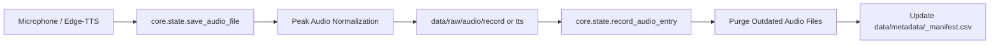

# 📖 Kabil Voice Assistant — Setup & Developer Guidelines


Welcome to **Kabil**, the first open-source, multilingual voice assistant and Speech/NLP research framework dedicated to low-resource languages—focusing primarily on **Chakma (𑄌𑄇𑄴𑄟)** and **Pali (Pāḷi / 𑄛𑅄𑄨)**, alongside **Bengali (বাংলা)** and **English**.

This document serves as the complete, authoritative manual for:
1. Setting up your local environment from scratch.
2. Running and navigating the unified Data Collection & Review Web App.
3. Managing, expanding, and validating audio datasets and parallel text corpora.
4. Adhering to architectural standards, audio recording best practices, and contribution workflows.
5. Diagnosing and resolving common setup and runtime issues.

---

## 📑 Table of Contents

- [1. System Requirements & Prerequisites](#1-system-requirements--prerequisites)
  - [1.1 Software & Runtimes](#11-software--runtimes)
  - [1.2 Hardware Recommendations](#12-hardware-recommendations)
  - [1.3 Font Setup for Native Chakma Script](#13-font-setup-for-native-chakma-script)
- [2. Quickstart Installation Guide](#2-quickstart-installation-guide)
  - [Step 1: Clone the Repository](#step-1-clone-the-repository)
  - [Step 2: Create a Virtual Environment](#step-2-create-a-virtual-environment)
  - [Step 3: Activate the Virtual Environment](#step-3-activate-the-virtual-environment)
  - [Step 4: Upgrade Pip & Install Dependencies](#step-4-upgrade-pip--install-dependencies)
  - [Step 5: Verify the Installation](#step-5-verify-the-installation)
- [3. Running the Unified Web Suite](#3-running-the-unified-web-suite)
  - [3.1 Launching the Server](#31-launching-the-server)
  - [3.2 Accessing the Application](#32-accessing-the-application)
  - [3.3 Deep-Linking & URL Navigation](#33-deep-linking--url-navigation)
- [4. Repository Architecture](#4-repository-architecture)
  - [4.1 Directory Breakdown](#41-directory-breakdown)
  - [4.2 Core State & Manifest Pipeline](#42-core-state--manifest-pipeline)
  - [4.3 File Naming & Organization Rules](#43-file-naming--organization-rules)
- [5. Application Modules & User Guide](#5-application-modules--user-guide)
  - [5.1 Tab 1: 🎙️ Record New Sentences](#51-tab-1-️-record-new-sentences)
  - [5.2 Tab 2: 🔍 Review & Re-record](#52-tab-2--review--re-record)
  - [5.3 Tab 3: 🎵 Voice Tracks Player & Dataset Explorer](#53-tab-3--voice-tracks-player--dataset-explorer)
- [6. Corpus & Dataset Management](#6-corpus--dataset-management)
  - [6.1 Corpus Format Standard](#61-corpus-format-standard)
  - [6.2 Generating & Expanding Parallel Corpora](#62-generating--expanding-parallel-corpora)
  - [6.3 Manifest Schema Specification](#63-manifest-schema-specification)
- [7. Audio Recording & Annotation Guidelines](#7-audio-recording--annotation-guidelines)
  - [7.1 Acoustic & Hardware Environment](#71-acoustic--hardware-environment)
  - [7.2 Language-Specific Pronunciation Rules](#72-language-specific-pronunciation-rules)
- [8. Neural TTS Engine (Edge-TTS) Pipeline](#8-neural-tts-engine-edge-tts-pipeline)
  - [8.1 Voice Models & Mapping](#81-voice-models--mapping)
  - [8.2 Chakma Unicode Transliteration Handling](#82-chakma-unicode-transliteration-handling)
  - [8.3 Cache vs Permanent Storage](#83-cache-vs-permanent-storage)
- [9. Development Standards & Git Workflow](#9-development-standards--git-workflow)
  - [9.1 Coding Conventions](#91-coding-conventions)
  - [9.2 Git Branching & Commit Guidelines](#92-git-branching--commit-guidelines)
- [10. Troubleshooting & FAQ](#10-troubleshooting--faq)

---

## 1. System Requirements & Prerequisites

### 1.1 Software & Runtimes

| Requirement | Supported Version | Notes |
| :--- | :--- | :--- |
| **Python** | `3.10` – `3.12+` (tested up to `3.14`) | Standard CPython distribution |
| **Operating System** | Windows 10/11, Linux (Ubuntu, Debian, Arch), macOS | Tested across Windows and Unix platforms |
| **Web Browser** | Google Chrome, Microsoft Edge, Mozilla Firefox | Requires microphone permission for recording |
| **Git** | `2.30+` | For version control and repository cloning |
| **Internet Access** | Active connection | Required for Microsoft Edge Neural TTS speech synthesis |

### 1.2 Hardware Recommendations

- **CPU:** Dual-core or quad-core processor (Intel Core i3/i5/i7, AMD Ryzen, Apple Silicon M-series).
- **RAM:** Minimum 4 GB RAM (8 GB+ recommended).
- **Audio Gear:** External USB headset or condenser microphone (preferred for low-noise speech sampling). Built-in laptop microphones are acceptable in quiet environments.
- **Embedded Targets (Future/Edge Deployment):** Raspberry Pi 4 / 5, ESP32, or edge microcontrollers running quantized TFLite / ONNX models.

### 1.3 Font Setup for Native Chakma Script

The Chakma script belongs to the Unicode standard (`U+11100` – `U+1114F`). Without an appropriate Unicode font installed, text containing Chakma characters (such as `𑄌𑄇𑄴𑄟`) will appear as empty rectangular boxes (`□` / "tofu").

**Recommended Fonts:**
1. **Noto Sans Chakma** (Official Google Fonts): [Download Noto Sans Chakma](https://fonts.google.com/specimen/Noto+Sans+Chakma)
2. **RibengUni** (Community standard for Chakma script): Widely used for Chakma literature and digital media.

**Quick Font Installation:**
- **Windows:** Download the `.ttf` or `.otf` file, right-click and select **Install for all users**.
- **macOS:** Double-click the `.ttf` file and click **Install Font** in Font Book.
- **Linux:** Copy the `.ttf` files to `~/.local/share/fonts/` (or `/usr/share/fonts/`) and update the cache with `fc-cache -f -v`.

---

## 2. Quickstart Installation Guide

Follow these sequential steps to configure your local development environment.

### Step 1: Clone the Repository

Open your terminal (PowerShell, Command Prompt, or Bash) and clone the repository:

```bash
git clone https://github.com/your-username/Kabil-Voice-Assistant.git
cd Kabil-Voice-Assistant
```

### Step 2: Create a Virtual Environment

Isolate project dependencies by setting up a clean Python virtual environment (`.venv`):

```bash
# Windows / macOS / Linux
python -m venv .venv
```

*(Note: On systems where multiple Python versions are installed, specify Python 3 explicitly, e.g., `python3 -m venv .venv` or `py -3.11 -m venv .venv`)*.

### Step 3: Activate the Virtual Environment

Activate the environment based on your operating system and shell:

- **Windows (PowerShell):**
  ```powershell
  .\.venv\Scripts\Activate.ps1
  ```
  *(If execution is blocked by PowerShell policy, run: `Set-ExecutionPolicy -ExecutionPolicy RemoteSigned -Scope CurrentUser`)*

- **Windows (Command Prompt):**
  ```cmd
  .\.venv\Scripts\activate.bat
  ```

- **macOS & Linux (Bash / Zsh):**
  ```bash
  source .venv/bin/activate
  ```

After activation, your prompt will display `(.venv)` at the beginning.

### Step 4: Upgrade Pip & Install Dependencies

Upgrade your package installer and install the required libraries from [requirements.txt](requirements.txt):

```bash
python -m pip install --upgrade pip
pip install -r requirements.txt
```

#### Core Dependencies Included:
- `fastapi` & `uvicorn`: High-performance asynchronous REST backend serving static audio files and hosting the app.
- `gradio`: Interactive, reactive browser UI for speech recording, review, and tabular analytics.
- `scipy` & `numpy`: Digital audio signal processing, waveform normalization, and array-to-WAV conversion.
- `pandas`: Dataframe manipulation and paginated audio table indexing.
- `edge-tts`: High-fidelity neural voice synthesis engine for multi-language speech generation.
- `pydub`: Dynamic audio format manipulation and file verification.

### Step 5: Verify the Installation

Run this quick verification one-liner:

```bash
python -c "import fastapi, uvicorn, gradio, scipy, numpy, pandas, edge_tts; print('✅ Kabil dependencies loaded successfully!')"
```

If it prints `✅ Kabil dependencies loaded successfully!`, your environment is ready.

---

## 3. Running the Unified Web Suite

### 3.1 Launching the Server

Execute the main entry point from the project root:

```bash
python app.py
```

You should see terminal output similar to:

```text
Starting Kabil Voice Assistant App...
Access the unified app at: http://127.0.0.1:8000/
--------------------------------------------------
INFO:     Started server process
INFO:     Waiting for application startup.
INFO:     Application startup complete.
INFO:     Uvicorn running on http://127.0.0.1:8000 (Press CTRL+C to quit)
```

### 3.2 Accessing the Application

Open your browser and navigate to:

👉 **[http://127.0.0.1:8000/](http://127.0.0.1:8000/)**

> [!NOTE]
> The application unites both FastAPI (serving the `/data` audio backend) and Gradio (rendering the interactive workspace) on a single port (`8000`).

### 3.3 Deep-Linking & URL Navigation

The app supports URL query parameters for rapid navigation and reviewer collaboration:

- **Open the Review Tab directly:**
  ```text
  http://127.0.0.1:8000/?tab=review
  ```
- **Open a specific audio track in the Review tab by index:**
  ```text
  http://127.0.0.1:8000/?tab=review&id=12
  ```
  *(This automatically selects track `#12` and loads its audio and transcript into the editor).*

---

## 4. Repository Architecture

### 4.1 Directory Breakdown

The project follows a modular, decoupled architecture:

```text
Kabil-Voice-Assistant/
├── api/                            # Future REST/WebSocket endpoints for ASR, TTS, and NLU
├── assets/                         # Static assets (logos, icons, styling resources)
├── components/                     # Modular Gradio interface tabs
│   ├── __init__.py
│   ├── tab1_record.py              # Microphone recording & sequential unrecorded queue
│   ├── tab2_review.py              # Review, re-recording, TTS generation & reconciliation
│   ├── tab3_player.py              # Paginated track player, filters, and full-screen view
│   └── tts_utils.py                # Edge-TTS voice mappings and synthesis helpers
├── core/                           # Central backend engine & state management
│   ├── __init__.py
│   └── state.py                    # Audio normalization, manifest I/O, cache & file isolation
├── data/                           # Data storage (git-tracked metadata, ignored binary media)
│   ├── metadata/                   # Language-isolated manifests (CSV)
│   │   ├── bn_manifest.csv         # Bengali recordings manifest
│   │   ├── ch_manifest.csv         # Chakma recordings manifest
│   │   ├── en_manifest.csv         # English recordings manifest
│   │   └── pl_manifest.csv         # Pali recordings manifest
│   └── raw/                        # Raw parallel text files and audio files
│       ├── bangla.txt              # Bengali text corpus
│       ├── chakma.txt              # Chakma text corpus (Script | Translit — Meaning)
│       ├── english.txt             # English text corpus
│       ├── pali.txt                # Pali text corpus (Roman | Bangla/Chakma — Meaning)
│       └── audio/
│           ├── record/             # Standard microphone WAV recordings
│           ├── tts/                # Finalized auto-generated TTS audio files (MP3)
│           └── tts_cache/          # Transient preview audio files (safe to clear anytime)
├── docs/                           # Technical documentation and linguistic guidelines
│   ├── architecture/               # System and embedded deployment schematics
│   ├── contributing/               # Extended contributor handbooks
│   └── dataset_guidelines/
│       └── phoneme_mapping.md      # G2P mapping, Chakma vowel signs, consonants, and IPA
├── embedded/                       # Edge AI firmware & model quantization (ESP32 / Pi)
├── models/                         # Trained model weights & config checkpoints (ASR, TTS)
├── scripts/                        # Utility scripts for data collection and training pipelines
├── app.py                          # Unified application entry point (FastAPI + Gradio)
├── generate_corpus.py              # Procedural sentence generator for Chakma & Pali
├── generate_parallel_corpus.py     # 4-way parallel corpus generator (Chakma, Pali, BN, EN)
├── requirements.txt                # Root Python package dependencies
├── README.md                       # High-level project summary
├── CHANGELOG.md                    # Detailed version history and changelog
├── RELEASE_NOTES.md                # Release summaries and storage architecture notes
└── SETUP&GUIDELINE.md              # This setup and developer guideline file
```

### 4.2 Core State & Manifest Pipeline

All disk operations, file writing, normalization, and metadata synchronizations are strictly coordinated through [core/state.py](core/state.py). This prevents concurrency bugs and keeps business logic out of UI rendering scripts:



### 4.3 File Naming & Organization Rules

To ensure database consistency and prevent collision or overwriting accidents:

1. **Audio File Naming:** Every audio file strictly follows the pattern:
   ```text
   <lang_prefix>_<random10>.<ext>
   ```
   - `ch_` = Chakma (e.g., `ch_1b9868ecdd.wav`)
   - `pl_` = Pali (e.g., `pl_75cff10835.wav`)
   - `bn_` = Bengali (e.g., `bn_74d6318a85.wav`)
   - `en_` = English (e.g., `en_626d69e73e.wav`)
2. **Audio File Extensions:**
   - Microphone recordings: `.wav` (PCM 16-bit, peak-normalized).
   - Synthesized voices: `.mp3` (MPEG Layer-3 stream from Edge-TTS).
3. **Automatic Storage Reconciliation:**
   - When a sentence is re-recorded or re-synthesized, `core.state.record_audio_entry` automatically identifies the obsolete audio file on disk, deletes it safely, and replaces the manifest row with the new file path. This guarantees zero orphaned audio files.

---

## 5. Application Modules & User Guide

The unified UI is divided into three focused workspaces:

### 5.1 Tab 1: 🎙️ Record New Sentences

Designed for uninterrupted, high-throughput recording sessions by native speakers and annotators.

- **Category Selector:** Select your working language:
  - `বাংলা — বাংলা (Bengali) - English`
  - `𑄌𑄇𑄴𑄟 — 𑄌𑄇𑄴𑄟 (Bengali | Chakma) - English`
  - `Pāḷi — Pāḷi (পাল়ি | 𑄛𑅄𑄨) - English`
  - `English — English (Bengali | 𑄌𑄇𑄴𑄟 | Pāḷi)`
- **Dynamic Unrecorded Queue:** The UI strictly filters sentences based on verified local storage. A sentence is considered completed and hidden from Tab 1 only if it is recorded in the metadata manifest AND its audio file physically exists in the local `audio/record/` folder. If any audio file or sentence is deleted from local storage, it immediately reappears in Tab 1 as unrecorded.
- **Proof Text (In-Place Correction Modal):** If you spot a typo, misspelling, or error in either the spoken sentence or its context/transliteration, click the **Proof Text** button. A clean pop-up modal opens allowing you to edit the primary script transcript and context. Saving automatically updates the local raw data file (`data/raw/*.txt`), synchronizes the in-memory queue, and updates any existing manifest entries.
- **Skip & Advance:** Skip tricky sentences with **Skip**, or navigate forward/backward with **◀ Prev** and **Next ▶**.
- **Submit & Next:** Saves the recorded audio for the current sentence and automatically moves to the next unrecorded prompt.
- **Instant TTS Generation Option:** If a human speaker is unavailable, select the voice accent and click **Generate Voice** to synthesize and populate the buffer instantly.
- **Auto-Advance:** Saving immediately logs the audio and advances to the next unrecorded prompt.

### 5.2 Tab 2: 🔍 Review & Re-record

Dedicated to quality control, pronunciation audits, and selective audio replacement.

- **Sentence Selector:** Lists all sentences in the corpus.
- **Audio Inspector:** Plays back the currently associated audio file.
- **In-Place Re-recording:** Record a new take and click **Save Re-recording**. The previous audio file is automatically erased from the disk to preserve storage space.
- **Advanced Neural TTS Panel:**
  - Select voice region and gender (`Bangla BD/IN`, `English US`, `Pali Sinhala style`, `Pali Hindi style`, `Female` / `Male`).
  - **Read:** Streams a transient preview into the browser.
  - **Generate:** Produces a clean MP3 in `data/raw/audio/tts/` and replaces the existing recording.
  - **Clear Cache:** Flushes temporary preview files from `data/raw/audio/tts_cache/` in one click.

### 5.3 Tab 3: 🎵 Voice Tracks Player & Dataset Explorer

A dashboard for exploring, auditing, and playing your recorded dataset.

- **Paginated Table:** Shows 10 recordings per page with pagination buttons (`Previous`, `Next`, `Jump to page`).
- **Interactive Playback:** Clicking any row immediately plays that recording.
- **Live Search & Filter:** Filter by specific language or search by keyword across all transcripts in real time.
- **Fullscreen Mode:** Click the maximize/fullscreen icon to expand the view to all tracks without pagination constraints.
- **Deep-Link to Review:** Click the **Review** button on any row to automatically jump to the Review Tab with that track selected.

---

## 6. Corpus & Dataset Management

### 6.1 Corpus Format Standard

Raw textual datasets reside in `data/raw/*.txt`. Each line follows the standardized schema:

```text
<PrimaryScript> | (<AuxiliaryScripts_or_Transliteration>) — <EnglishMeaning>
```

#### Examples:

- **Chakma (`data/raw/chakma.txt`):**
  ```text
  𑄃𑄎𑄴𑄠𑄧 𑄟𑄪𑄃𑄨 𑄞𑄧𑄖𑄴 𑄈𑄋𑄴 | (আজ্যা মুই ভাত খাং | Ajya mui bhat khang.) — Today I eat rice.
  ```
- **Pali (`data/raw/pali.txt`):**
  ```text
  Ajja Ahaṃ odanaṃ bhuñjāmi. | (অজ্জ অহং ওদনং ভুঞ্জামি | 𑄃𑄎𑄴𑄎 𑄃𑄦𑄁 𑄃𑄮𑄘𑄚𑄁 𑄞𑄪𑄐𑄴𑄎𑄧𑄟𑄨) — Today I eat rice.
  ```
- **Bengali (`data/raw/bangla.txt`):**
  ```text
  আজ আমি ভাত খাই। | (Aj ami bhat khai.) — Today I eat rice.
  ```
- **English (`data/raw/english.txt`):**
  ```text
  Today I eat rice. | (আজ আমি ভাত খাই। | 𑄃𑄎𑄴𑄠𑄧 𑄟𑄪𑄃𑄨 𑄞𑄧𑄖𑄴 𑄈𑄋𑄴 | Ajja Ahaṃ odanaṃ bhuñjāmi.)
  ```

### 6.2 Generating & Expanding Parallel Corpora

Kabil includes automated procedural generators that construct grammatical sentence matrices across all four languages:

```bash
# Generate complete 4-way parallel corpus in data/raw/
python generate_parallel_corpus.py
```

This generates thousands of aligned sentences across diverse subjects, verbs, temporal indicators, and adjectives.

To add new grammatical components or vocabulary, edit [generate_parallel_corpus.py](generate_parallel_corpus.py):
1. Add vocabulary objects with `en`, `bn`, `bn_t`, `ck_b`, `ck_t`, `ck_s`, `pa_r`, `pa_b`, `pa_c` keys.
2. Run `python generate_parallel_corpus.py` to regenerate `data/raw/{chakma,pali,bangla,english}.txt`.

### 6.3 Manifest Schema Specification

Manifest files are stored in `data/metadata/<lang_prefix>_manifest.csv` with standard comma-separated fields:

| Header | Type | Description | Example |
| :--- | :--- | :--- | :--- |
| `file_path` | string | Relative path from project root | `data/raw/audio/record/ch_cf0e5ac1ad.wav` |
| `transcript` | string | Primary script text spoken in audio | `𑄃𑄎𑄴𑄠𑄧 𑄟𑄪𑄃𑄨 𑄞𑄧𑄖𑄴 𑄈𑄋𑄴` |
| `language` | string | Canonical language name | `Chakma` |
| `status` | string | Track lifecycle state | `Ready` (or `Verified`, `Flagged`) |

---

## 7. Audio Recording & Annotation Guidelines

High-quality acoustic data is essential for training competitive ASR and TTS neural models. Contributors and native speakers should follow these rules:

### 7.1 Acoustic & Hardware Environment

1. **Room Acoustics:** Record in a quiet room with minimal reverb/echo. Avoid rooms with bare walls and tile floors; soft furnishings, curtains, or carpets reduce reflection.
2. **Background Noise:** Turn off air conditioners, fans, or noisy appliances. Avoid recording near open windows facing traffic.
3. **Microphone Technique:**
   - Maintain a consistent mouth-to-microphone distance of **10 to 15 cm (4 to 6 inches)**.
   - Position the mic slightly to the side (30–45 degrees off-axis) or use a pop filter to prevent plosive distortion on 'p', 't', 'k', and 'ch' sounds.
4. **Natural Speech Cadence:** Speak at a steady, natural conversational pace. Do not over-enunciate like a robot, but do not slur words together.
5. **Silence Buffers:** Leave approximately **0.3 seconds of quiet** before speaking and after finishing each sentence to facilitate endpointing and voice activity detection (VAD).

### 7.2 Language-Specific Pronunciation Rules

For detailed linguistic rules, consult [docs/dataset_guidelines/phoneme_mapping.md](docs/dataset_guidelines/phoneme_mapping.md).

#### Chakma (𑄌𑄇𑄴𑄟):
- **Inherent Vowel:** In the Chakma abugida, unmarked consonants carry an inherent long vowel **`ā` (`/a:/`)** (e.g., 𑄇 = `/ka:/`), distinct from Bengali's inherent short `/ɔ/`.
- **Virama / Muting (𑄴):** Consonant clusters and final codas rely on the Virama mark (`𑄴`) to mute the inherent vowel (e.g., 𑄇𑄴 = `/k/`).
- **Allophonic Shifts:** Note that `𑄜` (`/pʰa:/`) in spoken dialects frequently shifts to `/fa:/`, and `𑄞` (`/bʰa:/`) can shift to `/va:/`.

#### Pali (Pāḷi):
- **Retroflex Consonants:** Pronounce retroflex sounds (`ṭ`, `ṭh`, `ḍ`, `ḍh`, `ṇ`) with the tip of the tongue curled back against the hard palate.
- **Aspirated Consonants:** Maintain clear distinction between unaspirated (`k`, `c`, `t`, `p`) and aspirated (`kh`, `ch`, `th`, `ph`) phonemes.
- **Niggahīta (Anusvāra `ṃ` / `ŋ`):** The nasal coda should sound as pure velar nasalization before pauses or assimilate to the following consonant's class.

---

## 8. Neural TTS Engine (Edge-TTS) Pipeline

### 8.1 Voice Models & Mapping

Kabil integrates Microsoft Edge Neural TTS voices through `edge-tts`:

| Language Target | Voice ID (Female) | Voice ID (Male) | Dialect / Style |
| :--- | :--- | :--- | :--- |
| **English** | `en-US-AriaNeural` | `en-US-GuyNeural` | General American English |
| **Bengali (BD)** | `bn-BD-NabanitaNeural` | `bn-BD-PradeepNeural` | Standard Bangladeshi Bengali |
| **Bengali (IN)** | `bn-IN-TanishaaNeural` | `bn-IN-BashkarNeural` | Indian Bengali (West Bengal) |
| **Chakma (BD)** | `bn-BD-NabanitaNeural` | `bn-BD-PradeepNeural` | Bengali phonetic transliteration |
| **Pali (Sinhala style)** | `si-LK-ThiliniNeural` | `si-LK-SameeraNeural` | Sri Lankan Theravada chanting cadence |
| **Pali (Hindi style)** | `hi-IN-SwaraNeural` | `hi-IN-MadhurNeural` | Classical Indian Sanskrit/Pali cadence |

### 8.2 Chakma Unicode Transliteration Handling

> [!IMPORTANT]
> Microsoft Edge TTS does not have native support for the Chakma Unicode block (`U+11100`–`U+1114F`). Sending raw Chakma script directly to the Edge TTS WebSocket triggers silent connection terminations.

**How Kabil Solves This:**
In [components/tab2_review.py](components/tab2_review.py) and [components/tts_utils.py](components/tts_utils.py), Kabil automatically parses the context tuple associated with the sentence. If generating speech for a Chakma sentence, the engine extracts the **Bengali script transliteration** from the parentheses:
```text
Raw Chakma:       𑄃𑄎𑄴𑄠𑄧 𑄟𑄪𑄃𑄨 𑄞𑄧𑄖𑄴 𑄈𑄋𑄴
Parsed Context:   (আজ্যা মুই ভাত খাং | Ajya mui bhat khang.)
Passed to TTS:    আজ্যা মুই ভাত খাং
```
This enables seamless, high-quality audio generation without crashes.

### 8.3 Cache vs Permanent Storage

- **`data/raw/audio/tts_cache/`**: Temporary MP3 files created when clicking "Read" for auditory previews. These can be safely purged at any time using the **Clear Cache** button in the UI or by calling `core.state.clear_tts_cache()`.
- **`data/raw/audio/tts/`**: Permanent MP3 files created when clicking "Generate" or saving TTS audio into a manifest.

---

## 9. Development Standards & Git Workflow

### 9.1 Coding Conventions

- **Python Version:** Compatible with Python 3.10 and later.
- **Code Style:** Follow PEP 8 guidelines. Use descriptive variable names and type annotations where feasible.
- **Imports:** Always maintain absolute imports or package-relative imports based on `PROJECT_ROOT` to prevent `ModuleNotFoundError` across different entry points:
  ```python
  import os
  import sys
  PROJECT_ROOT = os.path.dirname(os.path.dirname(os.path.abspath(__file__)))
  if PROJECT_ROOT not in sys.path:
      sys.path.append(PROJECT_ROOT)
  ```
- **Docstrings & Comments:** Preserve all existing docstrings, phoneme notes, and inline architectural comments.

### 9.2 Git Branching & Commit Guidelines

1. **Create a Dedicated Branch:** Never commit directly to `main`:
   ```bash
   git checkout -b feature/your-feature-name
   # or
   git checkout -b fix/issue-description
   ```
2. **Meaningful Commit Messages:** Use conventional commit syntax:
   - `feat: add Pali pronunciation phonetic table`
   - `fix: resolve windows cp1252 print encoding crash`
   - `docs: update setup and developer guidelines`
3. **Pull Request Protocol:** Before submitting a PR:
   - Ensure the server starts without errors (`python app.py`).
   - Ensure manifests have valid headers (`file_path,transcript,language,status`).
   - Do NOT commit `.venv/`, binary `.wav`/`.mp3` files, or large checkpoints directly into git.

---

## 10. Troubleshooting & FAQ

### Q1: Chakma text appears as blank square boxes (`□`) in my browser or terminal.
- **Cause:** Your operating system lacks a font covering the Chakma Unicode block (`U+11100`–`U+1114F`).
- **Solution:** Download and install [Google Noto Sans Chakma](https://fonts.google.com/specimen/Noto+Sans+Chakma) or the RibengUni font. Restart your browser after installation.

### Q2: Windows PowerShell gives `UnicodeEncodeError: 'charmap' codec can't encode characters`.
- **Cause:** Windows terminal defaults to legacy code page `cp1252`, which cannot print non-Latin Unicode characters.
- **Solution:** Force Python to use UTF-8 encoding in your terminal:
  ```powershell
  # Windows PowerShell:
  $env:PYTHONIOENCODING = "utf-8"
  # Or run Python in UTF-8 mode:
  python -X utf8 app.py
  ```

### Q3: The browser says "Microphone blocked" or "Permission denied".
- **Cause:** Browser security prevents microphone access on untrusted origins or HTTP.
- **Solution:** 
  - Ensure you are connecting via `http://localhost:8000` or `http://127.0.0.1:8000` (modern browsers treat `localhost` as a secure context).
  - Check browser permissions: click the site settings icon in the address bar and allow **Microphone** access.

### Q4: Port 8000 is already in use (`OSError: [Errno 98] Address already in use` or `WinError 10048`).
- **Cause:** Another process or previous instance of `app.py` is occupying port 8000.
- **Solution:**
  - Find and terminate the process holding port 8000:
    ```powershell
    # Windows PowerShell:
    Get-NetTCPConnection -LocalPort 8000 | Select-Object OwningProcess
    Stop-Process -Id <PID> -Force
    ```
    ```bash
    # Linux / macOS:
    lsof -ti:8000 | xargs kill -9
    ```
  - Or modify the port in [app.py](app.py#L636): `uvicorn.run(app, host="127.0.0.1", port=8080)`.

### Q5: Edge-TTS synthesis fails with WebSocket connection errors or 403 Forbidden (`WSServerHandshakeError: 403`).
- **Cause 1 (403 Forbidden / Invalid response status):** Microsoft periodically updates authentication tokens and Sec-MS-GEC handshake parameters for the Read Aloud WebSocket API. Outdated `edge-tts` packages get blocked with 403 Forbidden.
  - **Solution:** Upgrade `edge-tts` to the latest version (`>=7.3.1`):
    ```bash
    pip install --upgrade edge-tts
    ```
- **Cause 2 (Network / Script issues):** An active internet connection is required to communicate with Microsoft Edge TTS servers. Additionally, passing raw Chakma script without transliteration fails.
  - **Solution:** 
    - Check your internet connection.
    - Verify that the sentence contains context or transliteration metadata in [data/raw/](data/raw/). Kabil automatically falls back to phonetic Bengali transliteration.

### Q6: Can I run Kabil on embedded systems like Raspberry Pi or ESP32?
- **Answer:** Yes! The data collection and corpus tooling are designed to build datasets for training lightweight acoustic models. The `embedded/` directory is reserved for deploying quantized TFLite and ONNX runtime models directly to microcontrollers and single-board computers.

---

## 🤝 Need Help or Want to Contribute?

- **Issue Tracker:** Open an issue on GitHub for bug reports or feature requests.
- **Contributions:** Check [CONTRIBUTING.md](CONTRIBUTING.md) and [CODE_OF_CONDUCT.md](CODE_OF_CONDUCT.md).
- **Phoneme Mappings:** Reference [docs/dataset_guidelines/phoneme_mapping.md](docs/dataset_guidelines/phoneme_mapping.md).

*Empowering underrepresented voices through open-source language AI.* 🚀

